# COMP7005 SLW Protocol
### A Reliable UDP Protocol

*Will Otterbein, A01372608, 2026*


This report describes my implementation of a reliability layer on top of the UDP protocol.

This protocol is called the SLW protocol, because it is based off the sliding window protocol that we discussed in lecture with Go-Back-N as the retransmission mechanism (more on that in the **Protocol Implementation** section).


## Application Message format and Integrity

The SLW protocol uses a network segment of 4096 bytes (this was the given buffer size & I decided to incorporate this as a segment size limitation), in the source the maximum network segment size is defined as `BUFFER_SIZE` in `include/common.h`.

These segments contain the SLW protocol header & some number of user data bytes.
 
```c
typedef struct slw_packet {
    uint8_t id;
    uint8_t ack;
    uint8_t flags;
    uint16_t checksum;
    uint16_t length;
    char data[SLW_MAX_PAYLOAD];
} slw_packet_t;
```

The header size is 7 bytes. One byte id number gives a 2^8 ID space, if this is the ID space then ACK field must also be 1 byte. Another byte is given for flags, which is how SLW determines the type of packet. SLW only uses 2 bits of this field at present, but in the name of consistency and potential extensibility it's nice to have another 5 bits to put to use. The checksum field is 2 bytes because this is the length of the checksum used by TCP, no need to reinvent the wheel. The length being 2 bytes means that maximum possible number of user bytes is (according to this field) is 2^16 = 65,536, cozily capping the maximum number of bytes to 65,535 which is also the maximum UDP datagram size. Of course the 7 header bytes would need to be subtracted from whatever user amount is supplied still, but this is handled by the protocol primitives to be discussed in the next section.

When written to the kernel buffer, the bytes are written in the order they are declared in the `slw_packet_t` type.

As a diagram, the header takes the following shape, this shape nested within the UDP datagram:

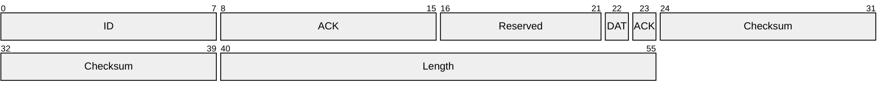


## Protocol Implementation

As mentioned in the introduction, SLW is an implementation of the sliding window protocol using go-back-N for retransmission. The SLW library is defined in `include/udp_slw.h` & implemented in `src/udp_slw.c`.

The goal of SLW is to improve upon the reliability of UDP, specifically with regard to the following:
- recovery from data loss
- recovery from out of order data
- recovery from data corruption
- recovery from duplicated data

At a macro level, SLW provides peer applications with send and receive windows within which outgoing & incoming packets can be queued. SLW guarantees that packets will be uncorrupted & that packets will be delivered in order, without duplication & retransmitted if necessary. Duplex communication is enabled by "piggy-backed" ACKs, meaning that any packet can simultaneously serve as a DAT & ACK packet, transmitting reply bytes with acknowledging received packets. SLW will adjust retransmission timers according to the state of the network, which will reduce unnecessary retransmission (as much as can be done using go-back-N strategy anyways).

<!--
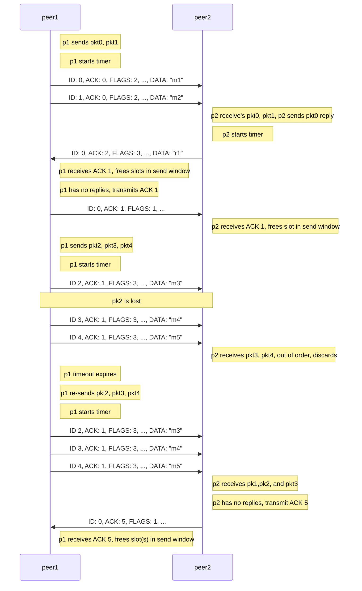
-->

*etc*

```c
typedef struct slw_state {
    int fd;
    int slots;
    time_t timeout;
    time_t senttime;
    time_t srtt;
    time_t rttv;
    time_t rtt;
    int timeoutdur;
    slw_window_t sndwind;
    slw_window_t rcvwind;
} slw_state_t;
```

> the SLW protocol state type.

```c
typedef struct slw_window {
    slw_packet_t* packets;
    int* slot_filled;
    int slots;
    int length;
    int base;
    int next;
    int ack;
} slw_window_t;
```

> a generic window type.

Practically, a calling application using SLW on top of UDP initializes a `slw_state_t` type, which holds references to the SLW send and receive windows and the state network (RTT time). The size of the send window is specifiable, up until the maximum allowable window size, which is 1 less than half the ID space, or 127 packets. The size of the receive window is always fixed at 1, this is because the SLW protocol adheres to go-back-N & therefore does not buffer packets that are received in advanced of the next expected packet.

```c
int slw_init(slw_state_t* state, int fd, int window_length, int timeoutdur)
{
    state->fd           = fd;
    state->slots        = SLW_MAX_SLOTS;

    /* timer initialization */

    state->rcvwind = (slw_window_t){
        .slots  = state->slots,
        .length = 1,
        .base   = 0,
        .next   = 0,
        .ack    = -1
    };
    state->sndwind = (slw_window_t){
        .slots  = state->slots,
        .length = min((window_length), SLW_MAX_WIND_LEN),
        .base   = 0,
        .next   = 0,
        .ack    = -1,
    };

    /* send/recv window memory allocation */
}
```

After initializing SLW protocol state, the calling application, according it's network event loop requirements, should pass the state amongst `slw_send`, `slw_recv`, and `slw_process` primitives. Other interfaces are exposed to calling applications, the `slw_init` & `slw_free` protocol state initialize/uninitialize functions, and the `slw_window_empty` function, but these functions are helpful utilities have a limited role compared to the three aforementioned primitives.

Rather than meticulously comb over every function in the SLW library, we will discuss the implementation of SLW in terms of the implementation of these three primitives & how the `udp_server` & `udp_client` applications had their event loops modified to use SLW over UDP.


### `slw_send`

```c
ssize_t slw_send(slw_state_t* state, const char* buf, size_t bufsize,
    const struct sockaddr* socka, socklen_t sockalen);
```

The `slw_send` primitive purpose is to synthesize a packet or packet(s) for the users data and append these packets to the send window. The first thing this function does is check that adding a new packet does not overfill the send window. This is done by taking the unsigned difference between the next index & the base index (unsigned is a shortcut to checking if the difference is zero & adding the number of slots). If the window is full, `SLW_EWOULDBLOCK` is returned signaling to the caller that there message was not delivered.

```c
int in_flight = (uint8_t)((sndwind->next - sndwind->base) % sndwind->slots);
if (in_flight >= sndwind->length) {
    return SLW_EWOULDBLOCK;
}
```

Then, the number of packets are calculated, this is for the case that the user transmits a message larger than the maximum possible payload size for a single packet. A loop begins creating & transmitting these packets, tracking the offset across the user supplied buffer if multiple packets need be sent. Packets are written to the send window slot according to the next index, the `slot_filled` for the next index is set to a value of `1` which is used elsewhere regarding windows to indicate whether a window slot has a packet or not. If the next pointer equals the base pointer (which means this is the first/only packet being transmitted), the SLW timeout is calculated.

To facilitate the piggy-backing of ACKs, there is an `ack` variable on each window, if this is greater than zero (which is the initial value) for the receive window, this value is written to the packet & the ACK flag is set. For user packets, the DAT flag is set as well.

```c
int curr = sndwind->next;
sndwind->next = candidate_next;

if (curr == sndwind->base) {
    state->senttime = slw_time_ms();
    slw_calc_timeout(state);
}
pkt->flags |= SLW_F_DAT;
if (rcvwind->ack > 0)
    pkt->flags |= SLW_F_ACK;
sndwind->slot_filled[sndwind->next] = 1;
```

Once the protocols accounting is complete, the packet is translated (byte-reordered) to a network segment buffer which is passed to the function `sendto_s`, a wrapper that just handles the error return `EINTR`, transmitting the packet over the wire. 

```c
char net_segment[BUFFER_SIZE];
slw_write_packet(net_segment, BUFFER_SIZE, pkt);

ssize_t sent_bytes = sendto_s(state->fd, net_segment,
    slw_packet_size(pkt), 0, socka, sockalen);
if (sent_bytes < 0) {
    return SLW_ERROR;
}
offset += chunk_len;
sent_count++;
```

The number of sent bytes is stored in the `offset` variable, in the case only part of the users content is delivered then can prepare to send again.


> In brief, the purpose of `slw_send` is to attempt to append a packet or packets to the SLW protocol's send window.


### `slw_recv`

```c
ssize_t slw_recv(slw_state_t* state, char* buf, size_t bufSize);
```

The purpose of the `slw_recv` primitive is to read received packets into a users buffer. Perhaps unintuitive, this function does not actually invoke `recv` (`recv_s` wrapper, really), rather it is solely responsible to check the receive window for packets, which to reiterate there will only ever be one of these per invocation due to go-back-N.

If there are no packets to receive, the method returns `SLW_EWOULDBLOCK`, this is checked by making use of the `slot_filled` array of the receive window, which is a companion "boolean" array of the `packets` array indicating whether at that index a packet has been populated.

```c
if (!rcvwind->slot_filled[rcvwind->base]) {
    return SLW_EWOULDBLOCK;
}
```

Essentially the reverse of the process in `slw_send` takes place, the function tracks the number of copied bytes from the packets in the receive window & writes their contents to the user buffer, though their is no synthesis of the packet structures as they are already parsed from the network & written into the receive window slots by `slw_process`. The copy loop iterates through all the filled slots of the receive window, or until the `total_copied` number of bytes would exceed the buffer size supplied by the user.

```c
slw_packet_t* pkt = &rcvwind->packets[curr];
if (total_copied + pkt->length > bufSize) {
    break;
}
memcpy(buf + total_copied, pkt->data, pkt->length);
total_copied += pkt->length;
curr = slw_advance(curr, rcvwind);
```

If no bytes were copied, the users buffer was too small for even one packet, so an `SLW_EBUFSIZE` is returned.

Finally, the function iterates from the base index resetting the slot_filled, while also advancing the receive window base index, & returns the `total_copied` number of bytes, so that the caller can know how much actual data sits in the buffer they supplied.


> In brief, the purpose of `slw_recv` is to attempt to consolidate available packets in the SLW protocol's send window & write their data into the user's supplied buffer.


### `slw_process`

*perhaps the most important function*

```c
int slw_process(slw_state_t* state,
    struct sockaddr* socka, socklen_t* sockalen);
```

This function is meant to be executed by callers according to their event loop involving the underlying UDP socket. The intention is that the process function executes when `poll` returns, either with or without data to process.

The first thing `slw_process` does is determine if retransmission needs to occur. `slw_process` gets the current time & checks whether the current time is greater than the `timeout` variable, if this is the case the `slw_retransmit` function is invoked, this function iterates over the send window & re-invokes `send_s` on the packet & restarts the transmission timer (resets `timeout`).

```c
if (sndwind->base != sndwind->next) {
    time_t curr_time = slw_time_ms();
    if (curr_time >= state->timeout) {
        slw_retransmit(state, socka, *sockalen);
    }
}
```

Next `slw_process` attempts to read a packet from the socket using `recvfrom_s` (which handles the `EINTR` return), it does so in a non-blocking fashion so as to immediately return from `slw_process` if `EWOULDBLOCK` or `EAGAIN` is returned, with `slw_process` returning the `SLW_EWOULDBLOCK` error code. Other errors result in `SLW_ERROR`. Finally, if the number of bytes returned by `recvfrom_s` is less than the size of the SLW header, the packet is dropped.

After the packet as been read from the kernel into the `raw_buf` representation of the network segment, it is parsed into a the `slw_packet_t` type via `slw_read_packet`, which triggers checksum recalculation & compares the re-calculated checksum against the one parsed from the network segment. Packet parsing fails (checksum, or packet size is invalid), the packet is dropped.

First ACK handling occurs. `slw_process` determines whether the packet is a valid ACK packet by checking the flags field of the packet & calculating if the ACK number of the packet is within the send window (using the serial arithmetic comparison functions `slw_seq_less` & `slw_seq_greater`), if so there are a number of operations to complete for SLW: The current time is now representative of an rtt, so the round trip variance and smoother error values are recalculated to determine a new expected delay value via `slw_update_rtt`; the send window needs to accordingly be updated, to do so the function iterates from the base index to (not including) the ACK, setting the `slot_filled` value to 0 & advancing the base index (at the end of this if the base index does not equal the next index, there are still packets in flight so a new timeout is calculated).

```c
int ack_not_in_window = (!(pkt.flags & SLW_F_ACK)) || (
    (pkt.ack == sndwind->base) ||
    (pkt.ack != sndwind->base && slw_seq_less(pkt.ack, sndwind->base)) ||
    (pkt.ack != sndwind->next && slw_seq_greater(pkt.ack, sndwind->next))
) || (sndwind->next == sndwind->base);
int ack_in_window = !ack_not_in_window;
if (ack_in_window) {
    // update the round trip time
    slw_update_rtt(state);
    while (sndwind->base != pkt.ack) {
        sndwind->slot_filled[sndwind->base] = 0;
        sndwind->base = slw_advance(sndwind->base, sndwind);
    }
    if (sndwind->base != sndwind->next) {
        slw_calc_timeout(state);
    }
    if (pkt.length == 0) {
        goto ok_return;
    }
}
```

Second there is the handling of the rest of the packet. The packet flags are checked to determine if the packet is a one containing data & if it is the expected next packet (meaning its id matches the next index of the receive window), & if so the packet is written to the next index of the receive window, with the receive window updating its ACK tracker accordingly & the receive windows next index is advanced. If the packet id is not the expected packet ID, then the `slw_transmit_ack` helper is invoked to transmit a pure ACK packet with the current next index of the receive window, with the purpose of informing the peer of the current expected packet, & the out of order packet is dropped.

```c
if ((pkt.flags & SLW_F_DAT)) {
    if (pkt.id == rcvwind->next) {
        rcvwind->packets[rcvwind->next] = pkt;
        rcvwind->slot_filled[rcvwind->next] = 1;
        rcvwind->next = slw_advance(rcvwind->next, rcvwind);
        rcvwind->ack = rcvwind->next; // the next packet ID, go back N
    } else if (slw_seq_less(pkt.id, rcvwind->next)){
        slw_transmit_ack(state, rcvwind->next, socka, sockalen);
    }
}
```

If processing completes normally or returns early via packet drop, `SLW_OK` is returned by `slw_process`.


> In brief, the purpose of `slw_process` is to handle the transmission logic of the protocol, typically executed first when the caller has determined that the underlying socket has data to be read from the kernel. This function reads UDP packets from the wire, & parses the SLW packet.

> Dropping packets mean aborting any further processing, so `slw_process` returns `SLW_OK`


### Server's use of SLW

This section will discuss how `udp_server` was modified to work with the SLW protocol.

Instead of immediately entering it's event loop on the UDP socket, the server initializes the `slw_state_t` SLW protocol state object supplying the user provided window length (or the default value of 5).

```c
int main(int argc, char** argv)
{
    int window_length = 5;
    if (argc < 2) {
        fprintf(stderr, "Usage: %s <listen-port> [<window-length>]\n", argv[0]);
        return EXIT_FAILURE;
    }
    if (argc == 3) {
        window_length = atoi(argv[2]);
    }

    /* earlier in main parsing of CLI arguments & socket creation */

    // [WO] slw server state
    slw_state_t state = { 0 };
    slw_init(&state, server_fd, window_length, 400);

    LINFO("SLW STATE: { fd: %d, slots: %d }", state.fd, state.slots);
    LINFO("SLW SNDWIND STATE: { slots: %d, length: %d }",
        state.sndwind.slots, state.sndwind.length);
    LINFO("SLW RCVWIND STATE: { slots: %d, length: %d }",
        state.rcvwind.slots, state.rcvwind.length);

    // [WO] slw server loop
    int r = slw_loop(&state, (struct sockaddr*)&local, sizeof(local));

    slw_free(&state); 
    close(server_fd);

    if (r == EXIT_FAILURE)
        return EXIT_FAILURE;

    return EXIT_SUCCESS;
}
```

The server enters it's event loop by invoking the `slw_loop` function, which begins polling on the `pollfd` object initialized for the socket's file descriptor using the `poll_s` wrapper (again handling `EINTR` returns). The timeout is set to -1 if the send window is empty (there's nothing outgoing, this peer is just waiting for traffic), otherwise some transmission is in progress & so the timeout is the current value of the state's `timeoutdur`.

If a timeout occurs (`poll_s` returns zero), then no reply was received from the peer. `slw_process` should be invoked to handle this situation, this function will handle retransmission.

If there is data from the peer, `slw_process` is first invoked in order to deal with ACK's and updating the server's send window as well as to append the packet to the server's receive window (if there is in fact data to append). Then `slw_recv` is to be invoked, which will write received packet data to the server's buffer & update the server's receive window. The existing server's application logic executes (echoing the data in the server's buffer to STDOUT) & then `slw_send` is invoked with the server's buffer (transmitting the same data back to the peer), appending the packet to the server's send window.

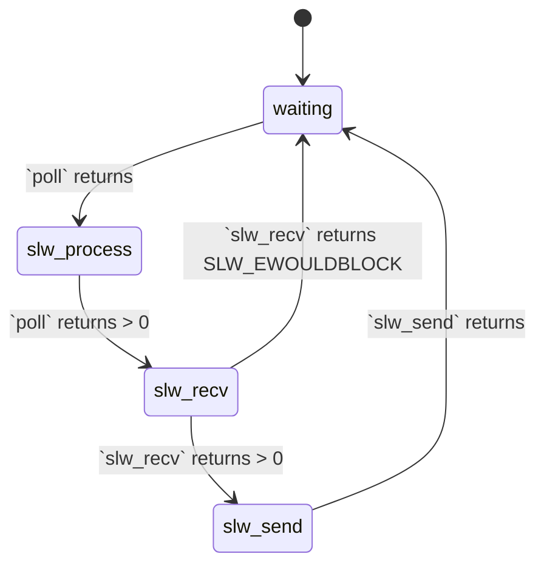


### Client's use of SLW

This section will discuss how `udp_client` was modified to work with the SLW protocol.

Like the `udp_server`, the `udp_client` first initializes the SLW protocol state `slw_state_t` object with the window length supplied by the command line (or with the default value of 5).

```c
int main(int argc, char** argv)
{
    int window_length = 5;
    if (argc < 3) {
        usage(argv[0]);
        return EXIT_FAILURE;
    }
    if (argc == 4) {
        window_length = atoi(argv[3]);
    }

    /* earlier in main parsing of CLI arguments & socket creation */

    // [WO] slw client state
    slw_state_t state = { 0 };
    slw_init(&state, client_fd, window_length, 400);

    LINFO("SLW STATE: { fd: %d, slots: %d }", state.fd, state.slots);
    LINFO("SLW SNDWIND STATE: { slots: %d, length: %d }",
        state.sndwind.slots, state.sndwind.length);
    LINFO("SLW RCVWIND STATE: { slots: %d, length: %d }",
        state.rcvwind.slots, state.rcvwind.length);

    // [WO] slw client loop
    int r = slw_loop(&state, (struct sockaddr*)&network, sizeof(network));
    (void)r;

    slw_free(&state);
    close(client_fd);

    if (r == EXIT_FAILURE)
        return EXIT_FAILURE;

    return EXIT_SUCCESS;
}
```

The client's event loop polls on both the socket FD and the STDIN FD, again with an infinite wait time (-1) if the SLW's send window is empty. If a timeout occurs, data is in transmission but no reply was received (and STDIN also has no new data to read in), but `slw_process` still needs to be invoked to determine if retransmission must be done for current in flight packets.

If the STDIN fd returns data (`POLLIN` or `POLLHUP`), STDIN is read into the clients buffer, & `slw_send` is invoked to transmit the contents of STDIN to the server. If the send window is full, the client's STDIN is not transmitted & the client prints a message stating "cannot send new messages at this time.".

If the socket fd returns data (`POLLIN`), then `slw_recv` is invoked to read the data into the clients buffer & echoed to `STDOUT`. In the case that `SLW_EWOULDBLOCK` is returned, the client simply moves on (there was no data to read, this will be the case if a pure ACK was transmitted). 

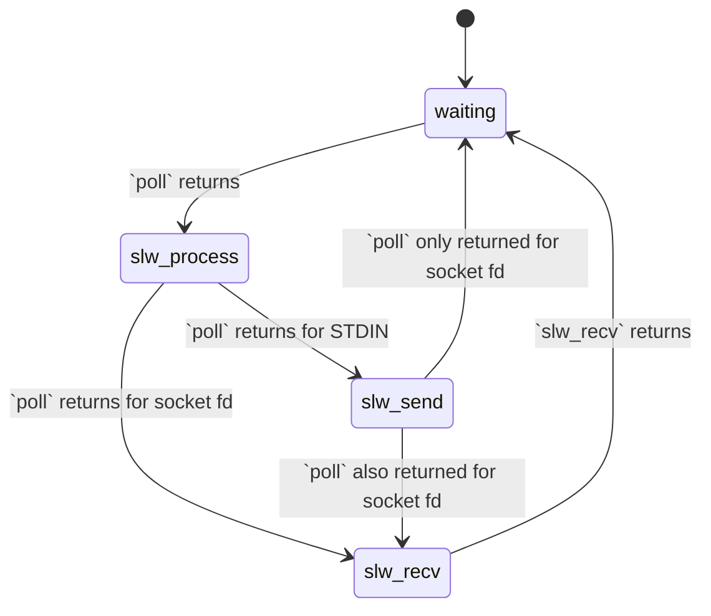

> If `SLW_EBUFSIZE` is returned, the client does nothing (which is not a good solution because this will lead to unnecessary retransmission for a failed message).


## Testing Scenarios

For testing, I use the default window length of 5.

server:

```
./build/udp_server 8080
```

client:

```
./build/udp_client 127.0.0.1 8081
```

network:

```
./build/network --server-port 8080 --server-ip 127.0.0.1 --listen-port 8081
```


### Perfect

server:

```
./build/udp_server 8080 2> ./logs/server-perfect.log
```

client:

```
./build/udp_client 127.0.0.1 8081 2> ./logs/client-perfect.log
```

network:

```
./build/network --server-port 8080 --server-ip 127.0.0.1 --listen-port 8081 --loss 0 --delay 0 --corrupt 0 --max-delay-ms 0 --seed 7005
```

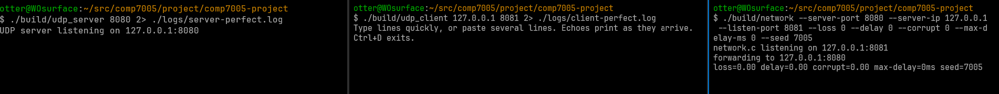

results:

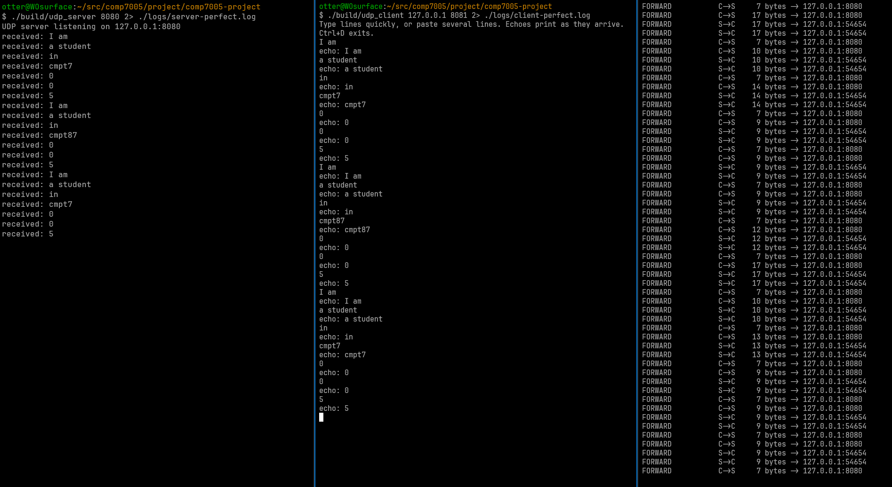


### Delay / Order

server:

```
./build/udp_server 8080 2> ./logs/server-delay-order.log
```

client:

```
./build/udp_client 127.0.0.1 8081 2> ./logs/client-delay-order.log
```

network:

```
./build/network --server-port 8080 --server-ip 127.0.0.1 --listen-port 8081 --loss 0 --delay 1 --corrupt 0 --max-delay-ms 1000 --seed 7005
```

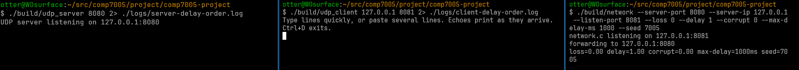

results:

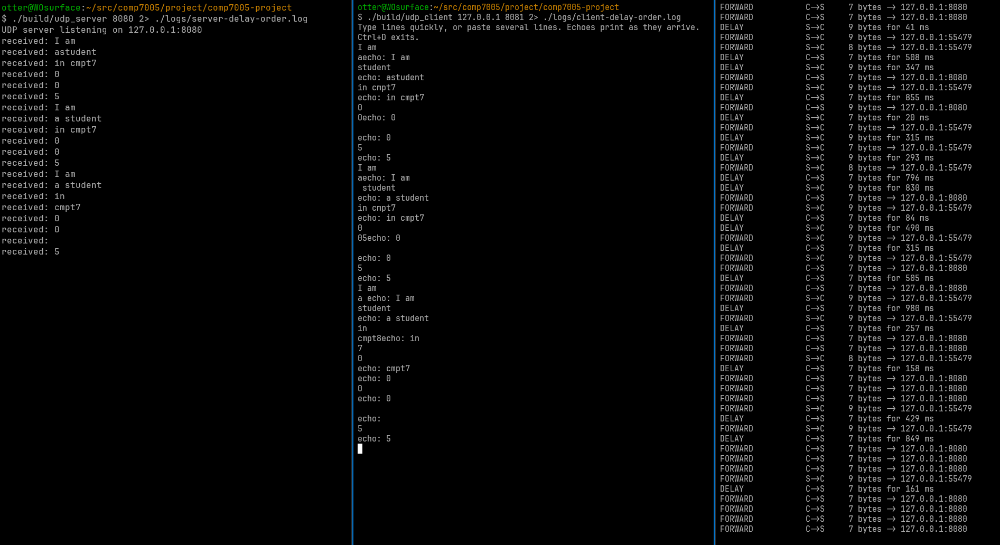


### Loss

server:

```
./build/udp_server 8080 2> ./logs/server-loss.log
```

client:

```
./build/udp_client 127.0.0.1 8081 2> ./logs/client-loss.log
```

network:

```
./build/network --server-port 8080 --server-ip 127.0.0.1 --listen-port 8081 --loss 0.50 --delay 0.10 --corrupt 0 --max-delay-ms 300 --seed 7005
```

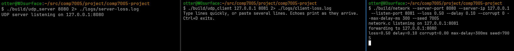

results:

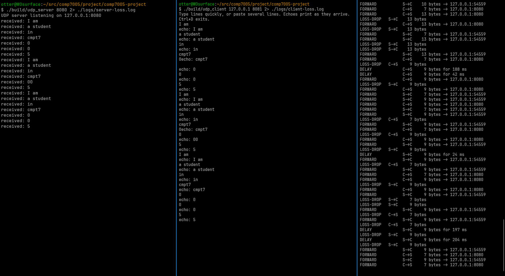

### Corruption

server:

```
./build/udp_server 8080 2> ./logs/server-corruption.log
```

client:

```
./build/udp_client 127.0.0.1 8081 2> ./logs/client-corruption.log
```

network:

```
./build/network --server-port 8080 --server-ip 127.0.0.1 --listen-port 8081 --loss 0 --delay 0.10 --corrupt 0.50 --max-delay-ms 300 --seed 7005
```

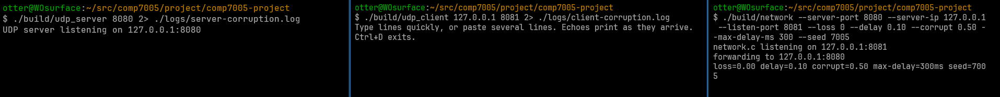

results:

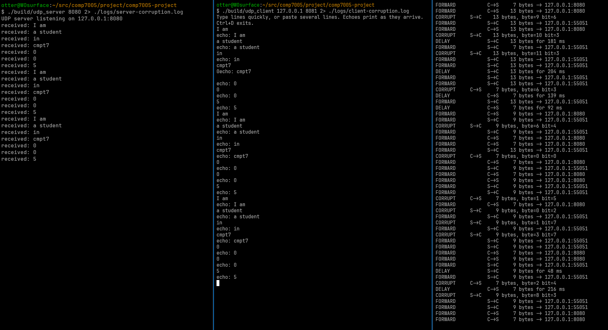

### Combined

server:

```
./build/udp_server 8080
```

client:

```
./build/udp_client 127.0.0.1 8081
```

network:

```
./build/network --server-port 8080 --server-ip 127.0.0.1 --listen-port 8081 --loss 0.10 --delay 0.50 --corrupt 0.05 --max-delay-ms 500 --seed 7005
```

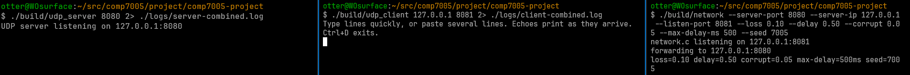

results:

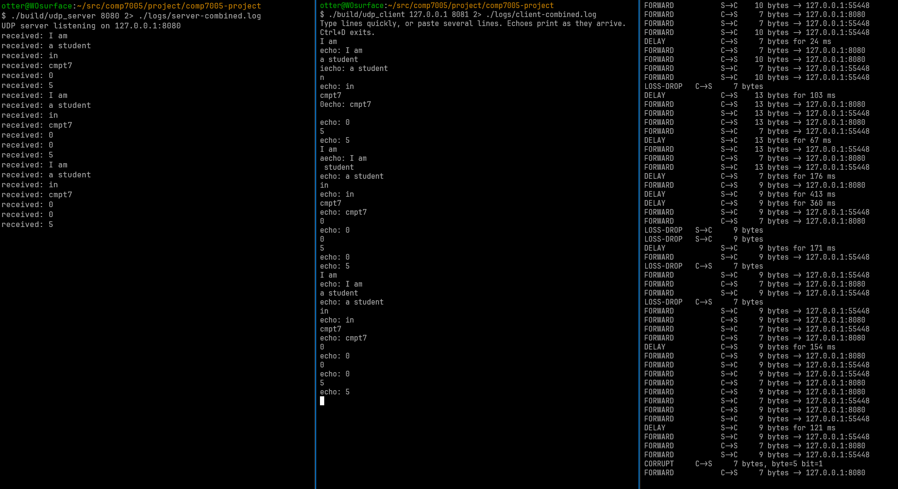

### ULTIMATE

server:

```
./build/udp_server 8080 25
```

client:

```
./build/udp_client 127.0.0.1 8081 25
```

use a window length of 25 & send all the messages at once

```
cat ./test/inputs.txt
```

network:

```
./build/network --server-port 8080 --server-ip 127.0.0.1 --listen-port 8081 --loss 0.10 --delay 0.50 --corrupt 0.05 --max-delay-ms 500 --seed 7005
```

with the extreme settings from the combined test

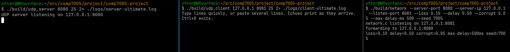

results:

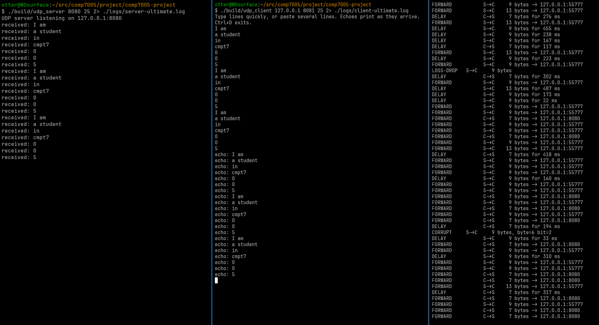


## Throughput Comparison

`./test/thrpt.sh`

In this experiment we are measuring successful messages for 2 different window lengths, the stop-and-wait (window size of 1) & window size 25 because I like number.

Success messages are defined as a round trip, therefore messages which the client is able to echo back to it's STDOUT.

Experiment parameters:
- Messages are transmitted every 0.05 seconds
- Messages are transmitted for a duration of 10 seconds

The network parameters are the same as the combined test from the scenarios.
```
./build/network --server-port 8080 --server-ip 127.0.0.1 --listen-port 8081 --loss 0.10 --delay 0.50 --corrupt 0.05 --max-delay-ms 500 --seed 7005
```

> The `thrpt.sh` testing script use `python3` for the monotime precision it offers over a pure bash script.

> SRT = successful rount trip

### Window Length of 1

```
for i in {1..5}; do ./test/thrpt.sh -r 0 -n "$i"; done
```

| Test No. | ID | Successful Messages | Logs | SRT/sec |
| :- | :- | :- | :- | :- |
| 1 | 1795766594 | 49 | [server-out](./logs/1795766594-server-out.log), [server-err](./logs/1795766594-server-err.log), [client-out](./logs/1795766594-client-out.log), [client-err](./logs/1795766594-client-err.log), [network](./logs/1795766594-network.log) | 4.9 |
| 2 | 1795766604 | 52 | [server-out](./logs/1795766604-server-out.log), [server-err](./logs/1795766604-server-err.log), [client-out](./logs/1795766604-client-out.log), [client-err](./logs/1795766604-client-err.log), [network](./logs/1795766604-network.log) | 5.2 |
| 3 | 1795766614 | 45 | [server-out](./logs/1795766614-server-out.log), [server-err](./logs/1795766614-server-err.log), [client-out](./logs/1795766614-client-out.log), [client-err](./logs/1795766614-client-err.log), [network](./logs/1795766614-network.log) | 4.5 |
| 4 | 1795766624 | 58 | [server-out](./logs/1795766624-server-out.log), [server-err](./logs/1795766624-server-err.log), [client-out](./logs/1795766624-client-out.log), [client-err](./logs/1795766624-client-err.log), [network](./logs/1795766624-network.log) | 5.8 |
| 5 | 1795766634 | 52 | [server-out](./logs/1795766634-server-out.log), [server-err](./logs/1795766634-server-err.log), [client-out](./logs/1795766634-client-out.log), [client-err](./logs/1795766634-client-err.log), [network](./logs/1795766634-network.log) | 5.2 |

Average SRT/sec = 25.6 / 5 = **5.12 SRT/sec**


### Window Length of 25

```
for i in {1..5}; do ./test/thrpt.sh -w 25 -r 0 -n "$i"; done
```

| Test No. | ID | Successful Messages | Logs | SRT/sec |
| :- | :- | :- | :- | :- |
| 1 | 1795766657 | 92 | [server-out](./logs/1795766657-server-out.log), [server-err](./logs/1795766657-server-err.log), [client-out](./logs/1795766657-client-out.log), [client-err](./logs/1795766657-client-err.log), [network](./logs/1795766657-network.log) | 9.2 |
| 2 | 1795766667 | 101 | [server-out](./logs/1795766667-server-out.log), [server-err](./logs/1795766667-server-err.log), [client-out](./logs/1795766667-client-out.log), [client-err](./logs/1795766667-client-err.log), [network](./logs/1795766667-network.log) | 10.1 |
| 3 | 1795766677 | 94 | [server-out](./logs/1795766677-server-out.log), [server-err](./logs/1795766677-server-err.log), [client-out](./logs/1795766677-client-out.log), [client-err](./logs/1795766677-client-err.log), [network](./logs/1795766677-network.log) | 9.4 |
| 4 | 1795766687 | 115 | [server-out](./logs/1795766687-server-out.log), [server-err](./logs/1795766687-server-err.log), [client-out](./logs/1795766687-client-out.log), [client-err](./logs/1795766687-client-err.log), [network](./logs/1795766687-network.log) | 11.5 |
| 5 | 1795766697 | 114 | [server-out](./logs/1795766697-server-out.log), [server-err](./logs/1795766697-server-err.log), [client-out](./logs/1795766697-client-out.log), [client-err](./logs/1795766697-client-err.log), [network](./logs/1795766697-network.log) | 11.4 |

Average SRT/sec = 51.6 / 5 = **10.32 SRT/sec**

## Reflection and Novelty

There are a few extensions to this project that I have considered, only one is asked of for the report so feel free to consider only the first section here, I think it's a more important development for the completeness of the library.

### Potential for Better Abstraction
- I want to create a version of `poll`, `slw_poll`, which will call `slw_process` on behalf of the calling application, returning poll errors / events such that the calling application is able to interface as with standard `poll`.
    - The calling application would have `slw_send` / `slw_recv`, with `slw_poll` replacing a public `slw_process`
    - `slw_poll` would invoke `poll` as per the calling applications inputs, handling the SLW protocol specific logic that exists on top of poll, which would mean that calling application's would not need to worry about checking send window emptiness to determine whether to poll infinitely or to poll as per the transmission timeout.
    - calling applications would not have to worry about calling `slw_process` on either `poll` timeout or data returned events for the socket.
    - There would need to be a contract about the order of the pollfds that `slw_poll` accepts, or `slw_poll` would copy the user supplied pollfds & place the `slw_state_t` first in the array so it knows which fd is the socket fd.
    - `slw_window_empty` would no longer need to be a public library function.
    - pretty much all the SLW protocol implementation details could be abstracted from the calling application which would be almost perfect.

### Connections
- The other thing I was thinking about would be implementing a `slw_listen` & `slw_connect`, because the current version of the protocol only works between 2 peers & does not validate whether packets are coming from the expected peer (its relatively easy to spoof SLW).
    - A connection handshake would occur with the SLW protocol creating a new socket for the connection once the handshake completes
    - I sort of implemented this in my first stop-and-wait protocol attempt (`include/udp_saw.h`, `src/udp_saw.c`) but it was not reliable & broke in the test scenarios because of that


## Appendix
Additional information about SLW & resources.

### SLW Serial Arithmetic (RFC 1982)

Because SLW has an ID space of 2^8 and the fact that SLW uses go-back-N for retransmission, maximum possible windows size would be 255, except that I implement the comparison arithmetic for serial numbers defined in [RFC 1982](https://www.rfc-editor.org/info/rfc1982/), where such comparisons only have meaning for 2^(n-1) in a space of 2^(n). Practically, this means that the maximum window size is 127 (128-1).

The comparison operations are implemented as the `slw_seq_less` & `slw_seq_greater` functions:

```c
static inline int slw_seq_less(uint8_t a, uint8_t b) {
    return (
        (a < b && (b - a < (SLW_MAX_SLOTS/2))) ||
        (a > b && (a - b > (SLW_MAX_SLOTS/2)))
    );
}

static inline int slw_seq_greater(uint8_t a, uint8_t b) {
    return (
        (a < b && (b - a > (SLW_MAX_SLOTS/2))) ||
        (a > b && (a - b < (SLW_MAX_SLOTS/2)))
    );
}
```

### SLW Checksum Calculation

SLW uses a very simple checksum, it sums all the bytes of the header & the payload, excluding the checksum bytes themselves. This is not a particularly strong checksum method, but that wasn't mentioned as a requirement, it works because of the simplicity of the application's on top of the SLW in this assignment.

```c
static uint16_t slw_compute_checksum(
    const uint8_t* header, uint16_t header_len,
    const char* body, uint16_t body_len
) {
    uint32_t sum = 0;
    for (int i = 0; i < header_len; i++) {
        if (i == 3 || i == 4) continue;
        sum += (uint8_t)header[i];
    }
    for (int i = 0; i < body_len; i++) {
        sum += (uint8_t)body[i];
    }
    return (uint16_t)sum;
}
```

### SLW RTT Tracking & Timer Calculations

RTT is tracked in the `slw_state_t` `rtt` field, this is calculated from the current monotonic time & the senttime of the base packet, upon determining that an incoming packet's ACK is within the send window.

```c
static inline void slw_update_rtt(slw_state_t* state) {
    state->rtt = slw_time_ms() - state->senttime;
}
```

The tracked RTT is used in the `slw_calc_timeout` function, which calculates RTT variation and smoothed RTT error, as per the equations discussed in out lectures, & which uses these numbers to determine the duration of the timeout & also the expected timeout monotime itself.

```c
static inline time_t slw_calc_timeout(slw_state_t* state) {
    time_t nrttv = (state->rttv != 0)
        ? (3/4)*(state->rttv) + (1/4)*(state->rtt - state->srtt)
        : (state->rtt)/2;
    time_t nsrtt = (state->srtt != 0)
        ? (7/8)*(state->srtt) + (1/8)*(state->rtt)
        : (state->rtt);
    time_t ntimeoutdur = nsrtt + max(SLW_MIN_TIMEOUT_MS, 4 * nrttv);

    state->srtt = nsrtt;
    state->rttv = nrttv;
    state->timeoutdur = ntimeoutdur;

    time_t ntimeout = slw_time_ms() + state->timeoutdur;
    state->timeout = ntimeout;
    return ntimeout;
}
```

> `SLW_MIN_TIMEOUT_MS` is defined as 50 ms.

The other time helpers are the following functions, responsible for retrieving monotonic time & normalizing it to milliseconds.

```c
static inline time_t slw_nmtime_ms(struct timespec ts) {
    return ( ts.tv_sec * 1000 ) + ( ts.tv_nsec / 1000000 );
}

static inline time_t slw_time_ms(void) {
    struct timespec ts;
    clock_gettime(CLOCK_MONOTONIC, &ts);
    return slw_nmtime_ms(ts);
}
```
