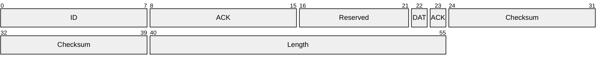
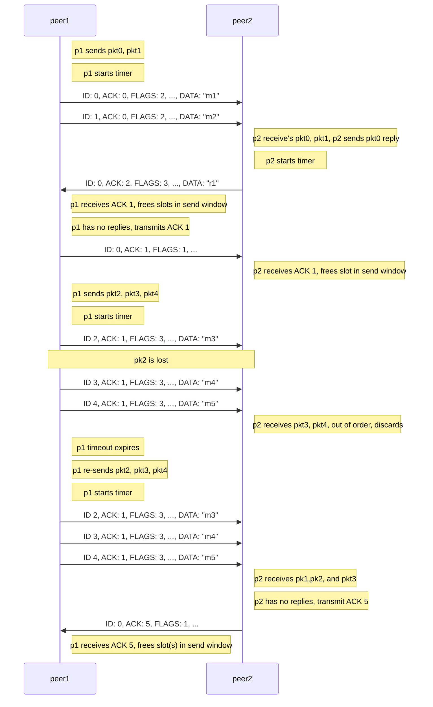

# COMP7005 SLW Protocol
### A Reliable UDP Protocol

*Will Otterbien, A01372608, 2026*


This report describes my implementation of a reliability layer on top of the UDP protocol.

This protocol is called the SLW protocol, because it is based off the sliding window protocol that we discussed in lecture with Go-Back-N as the retransmission mechanism (more on that in the **Protocol Implementation** section).


## Application Message format and Integrity

The SLW protocol uses a network segment of 4096 bytes (this was the given buffer size & I decided to incorporate this as a segment size limitation), in the source the maximum network segment size is defined as `BUFFER_SIZE` in `include/common.h`.

These segments contain the SLW protocol header & some number of user data bytes.
 
```c
typedef struct slw_packet {
    uint8_t id;
    uint8_t ack;
    uint8_t flags;
    uint16_t checksum;
    uint16_t length;
    char data[SLW_MAX_PAYLOAD];
} slw_packet_t;
```

The header size is 7 bytes. One byte id number gives a 2^8 ID space, if this is the ID space then ACK field must also be 1 byte. Another byte is given for flags, which is how SLW determines the type of packet. SLW only uses 2 bits of this field at present, but in the name of consistency and potential extensibility it's nice to have another 5 bits to put to use. The checksum field is 2 bytes because this is the length of the checksum used by TCP, no need to reinvent the wheel. The length being 2 bytes means that maximum possible number of user bytes is (according to this field) is 2^16 = 65,536, cozily capping the maximum number of bytes to 65,535 which is also the maximum UDP datagram size. Of course the 7 header bytes would need to be subtracted from whatever user amount is supplied still, but this is handled by the protocol primitives to be discussed in the next section.

When written to the kernel buffer, the bytes are written in the order they are declared in the `slw_packet_t` type.

As a diagram, the header takes the following shape, this shape nested within the UDP datagram:




## Protocol Implementation

As mentioned in the introduction, SLW is an implementation of the sliding window protocol. The SLW library is defined in `include/udp_slw.h` & implemented in `src/udp_slw.c` using go-back-N for retransmission.

The goal of SLW is to improve upon the reliability of UDP, specifically with regard to the following:
- recovery from data loss
- recovery from out of order data
- recovery from data corruption
- recovery from duplicated data

At a macro level, SLW provides peer applications with send and receive windows within which outgoing & incoming packets can be queued. SLW guarantees that packets will be uncorrupted & that packets will be delivered in order, without duplication & retransmitted if necessary. Duplex communication is enabled by "piggy-backed" ACKs, meaning that any packet can simultaneously serve as a DAT & ACK packet, transmitting reply bytes with acknowledging received packets. SLW will adjust retransmission timers according to the state of the network, which will reduce unnecessary retransmission (as much as can be done using go-back-N strategy anyways).


*etc*

The size of the send window is specifiable, up until the maximum allowable window size, which is 1 less than half the ID space, or 127 packets. The size of the receive window is always fixed at 1, this is because the SLW protocol adheres to go-back-N & therefore does not buffer packets that are received in advanced of the next expected packet.

```c
int slw_init(slw_state_t* state, int fd, int window_length, int timeoutdur)
{
    state->fd           = fd;
    state->slots        = SLW_MAX_SLOTS;

    /* timer initialization */

    state->rcvwind = (slw_window_t){
        .slots  = state->slots,
        .length = 1,
        .base   = 0,
        .next   = 0,
        .ack    = -1
    };
    state->sndwind = (slw_window_t){
        .slots  = state->slots,
        .length = min((window_length), SLW_MAX_WIND_LEN),
        .base   = 0,
        .next   = 0,
        .ack    = -1,
    };

    /* send/recv window memory allocation */
}
```

> more on how this is usable for the `udp_server` / `udp_client` applications in the proceeding sections.


From a calling applications perspective, the three most important primitives that the protocol library exposes are `slw_send`, `slw_recv`, `slw_process`. Other interfaces are exposed to calling applications, `slw_init` & `slw_free` protocol state initializers/"uninitializers", and the `slw_window_empty` function, but these functions are helpful utilities have a limited role compared to the three aforementioned primitives.

Rather than meticulously comb over every function in the SLW library, we will discuss the implementation of SLW in terms of the implementation of the three primitives & how the `udp_server` & `udp_client` applications were modified to use the SLW protocol, instead of pure UDP.


### `slw_send`

```c
ssize_t slw_send(slw_state_t* state, const char* buf, size_t bufsize,
    const struct sockaddr* socka, socklen_t sockalen);
```

The `slw_send` primitive purpose is to synthesize a packet or packet(s) for the users data and append these packets to the send window. The first thing this function does is check that adding a new packet does not overfill the send window. This is done by taking the unsigned difference between the next index & the base index (unsigned is a shortcut to checking if the difference is zero & adding the number of slots). If the window is full, `SLW_EWOULDBLOCK` is returned signaling to the caller that there message was not delivered.

```c
int in_flight = (uint8_t)((sndwind->next - sndwind->base) % sndwind->slots);
if (in_flight >= sndwind->length) {
    return SLW_EWOULDBLOCK;
}
```

Then, the number of packets are calculated, this is for the case that the user transmits a message larger than the maximum possible payload size for a single packet. A loop begins creating & transmitting these packets, tracking the offset across the user supplied buffer if multiple packets need be sent. Packets are written to the send window slot according to the next index, the `slot_filled` for the next index is set to a value of `1` which is used elsewhere regarding windows to indicate whether a window slot has a packet or not. If the next pointer equals the base pointer (which means this is the first/only packet being transmitted), the SLW timeout is calculated.

To facilitate the piggy-backing of ACKs, there is an `ack` variable on each window, if this is greater than zero (which is the initial value) for the receive window, this value is written to the packet & the ACK flag is set. For user packets, the DAT flag is set as well.

```c
int curr = sndwind->next;
sndwind->next = candidate_next;

if (curr == sndwind->base) {
    state->senttime = slw_time_ms();
    slw_calc_timeout(state);
}
pkt->flags |= SLW_F_DAT;
if (rcvwind->ack > 0)
    pkt->flags |= SLW_F_ACK;
sndwind->slot_filled[sndwind->next] = 1;
```

Once the protocols accounting is complete, the packet is translated (byte-reordered) to a network segment buffer which is passed to the function `sendto_s`, a wrapper that just handles the error return `EINTR`, transmitting the packet over the wire. 

```c
char net_segment[BUFFER_SIZE];
slw_write_packet(net_segment, BUFFER_SIZE, pkt);

ssize_t sent_bytes = sendto_s(state->fd, net_segment,
    slw_packet_size(pkt), 0, socka, sockalen);
if (sent_bytes < 0) {
    return SLW_ERROR;
}
offset += chunk_len;
sent_count++;
```

The number of sent bytes is stored in the `offset` variable, in the case only part of the users content is delivered then can prepare to send again.


> In brief, the purpose of `slw_send` is to attempt to append a packet or packets to the SLW protocol's send window.


### `slw_recv`

```c
ssize_t slw_recv(slw_state_t* state, char* buf, size_t bufSize);
```

The purpose of the `slw_recv` primitive is to read received packets into a users buffer. Perhaps unintuitive, this function does not actually invoke `recv` (`recv_s` wrapper, really), rather it is solely responsible to check the receive window for packets, which to reiterate there will only ever be one of these per invocation due to go-back-N.

If there are no packets to receive, the method returns `SLW_EWOULDBLOCK`, this is checked by making use of the `slot_filled` array of the receive window, which is a companion "boolean" array of the `packets` array indicating whether at that index a packet has been populated.

```c
if (!rcvwind->slot_filled[rcvwind->base]) {
    return SLW_EWOULDBLOCK;
}
```

Essentially the reverse of the process in `slw_send` takes place, the function tracks the number of copied bytes from the packets in the receive window & writes their contents to the user buffer, though their is no synthesis of the packet structures as they are already parsed from the network & written into the receive window slots by `slw_process`. The copy loop iterates through all the filled slots of the receive window, or until the `total_copied` number of bytes would exceed the buffer size supplied by the user.

```c
slw_packet_t* pkt = &rcvwind->packets[curr];
if (total_copied + pkt->length > bufSize) {
    break;
}
memcpy(buf + total_copied, pkt->data, pkt->length);
total_copied += pkt->length;
curr = slw_advance(curr, rcvwind);
```

If no bytes were copied, the users buffer was too small for even one packet, so an `SLW_EBUFSIZE` is returned.

Finally, the function iterates from the base index resetting the slot_filled, while also advancing the receive window base index, & returns the `total_copied` number of bytes, so that the caller can know how much actual data sits in the buffer they supplied.


> In brief, the purpose of `slw_recv` is to attempt to consolidate available packets in the SLW protocol's send window & write their data into the user's supplied buffer.


### `slw_process`

*perhaps the most important function*

```c
int slw_process(slw_state_t* state,
    struct sockaddr* socka, socklen_t* sockalen);
```


> In brief, the purpose of `slw_process` is to handle the transmission logic of the protocol, typically executed first when the caller has determined that the underlying socket has data to be read from the kernel. This function reads UDP packets from the wire, & parses the SLW packet.


### Server's use of SLW

This section will discuss how `udp_server` was modified to work with the SLW protocol.


### Client's use of SLW

This section will discuss how `udp_client` was modified to work with the SLW protocol.


## Testing Scenarios

## Throughput Comparison


## Reflection and Novelty


## Appendix

### Serial Arithmetic and RFC 1982

Because SLW has an ID space of 2^8 and the fact that SLW uses go-back-N for retransmission, maximum possible windows size would be 255, except that I implement the comparison arithmetic for serial numbers defined in [RFC 1982](https://www.rfc-editor.org/info/rfc1982/), where such comparisons only have meaning for 2^(n-1) in a space of 2^(n). Practically, this means that the maximum window size is 127 (128-1).

### SLW Checksum Calculation


